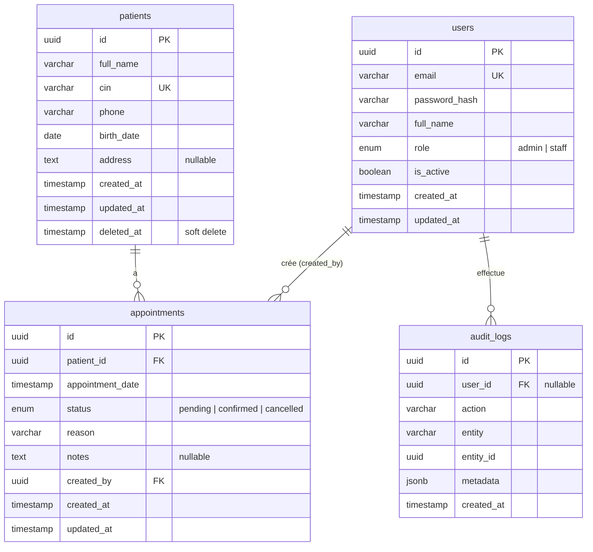

# Conception de la base de données

## ERD

## Relations

| Relation | Type | Justification |
|---|---|---|
| `patients` → `appointments` | 1-N | Un patient a plusieurs rendez-vous, un rendez-vous concerne un seul patient. |
| `users` → `appointments` (`created_by`) | 1-N | Traçabilité de l'auteur de chaque rendez-vous. |
| `users` → `audit_logs` | 1-N | Un utilisateur génère plusieurs entrées d'audit. |
| 1-1 / N-N | aucune | Pas nécessaire : un N-N apparaîtrait avec plusieurs médecins par rendez-vous. |

## Règles de suppression (clés étrangères)

| FK | Règle | Raison |
|---|---|---|
| `appointments.patient_id` | RESTRICT | L'historique médical n'est jamais supprimé physiquement. Les patients sont supprimés par soft delete (`deleted_at`). |
| `appointments.created_by` | RESTRICT | Un utilisateur est désactivé (`is_active = false`), pas supprimé. |
| `audit_logs.user_id` | SET NULL | Les logs survivent à la disparition de l'utilisateur. |

## Contraintes et intégrité

- Clés primaires **UUID** (`gen_random_uuid()`).
- `patients.cin` **UNIQUE**, `users.email` **UNIQUE** (en minuscules, contrainte CHECK).
- **ENUM** PostgreSQL pour `role` et `status`.
- `CHECK` : date de naissance non future.
- **Règle métier : un patient ne peut pas avoir 2 rendez-vous confirmés dans une fenêtre de 30 minutes.**
  Appliquée à deux niveaux :
  1. dans le service (message 409 clair) ;
  2. par une contrainte `EXCLUDE USING gist` en base (`appointments_no_overlap_confirmed`), qui garantit la règle même avec des requêtes simultanées.

## Index (performance)

| Index | Usage |
|---|---|
| GIN trigram sur `patients.full_name` et `patients.cin` | Recherche `ILIKE '%...%'` rapide |
| `appointments (patient_id, appointment_date)` | Page détail patient |
| `appointments (appointment_date, status)` | Filtres et dashboard |
| `appointments (created_by)` | Jointure utilisateur |
| `patients (created_at)`, `patients (deleted_at)` | Liste paginée, filtre soft delete |
| `audit_logs (entity, entity_id)`, `(user_id)`, `(created_at)` | Consultation du journal |

## Bonus implémentés

Soft delete, table d'audit alimentée, ENUM et contraintes CHECK.